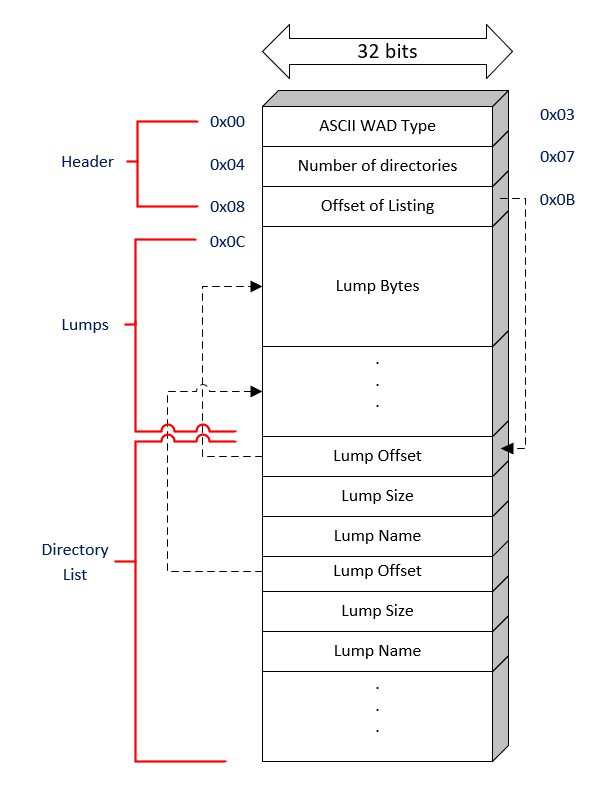
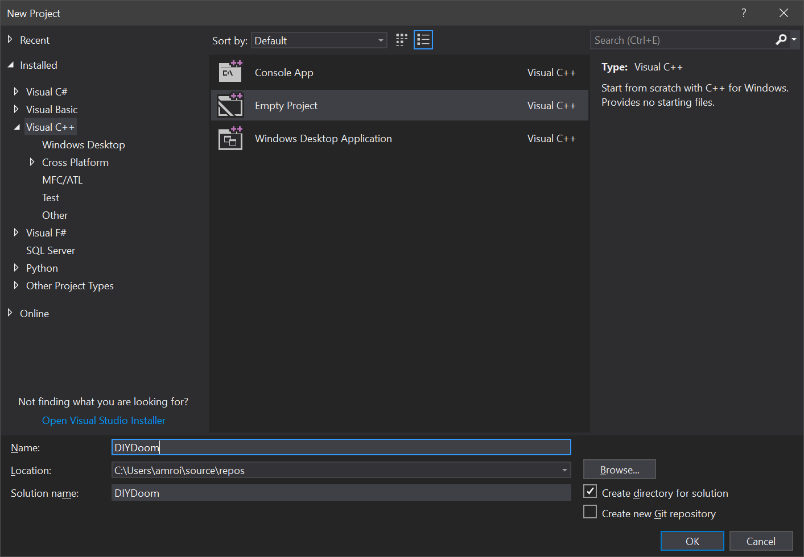
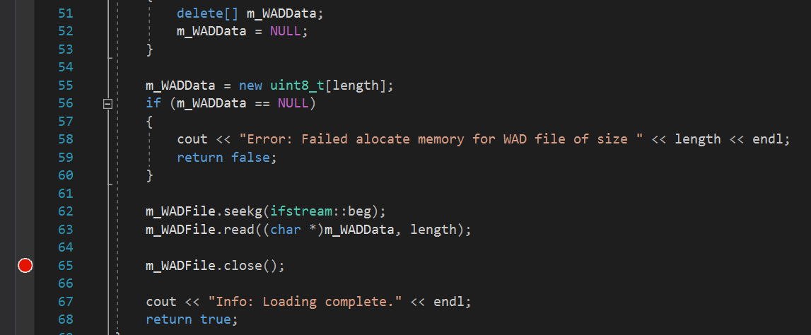
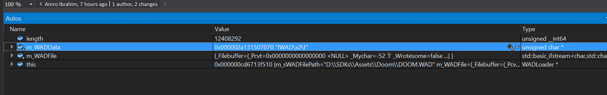
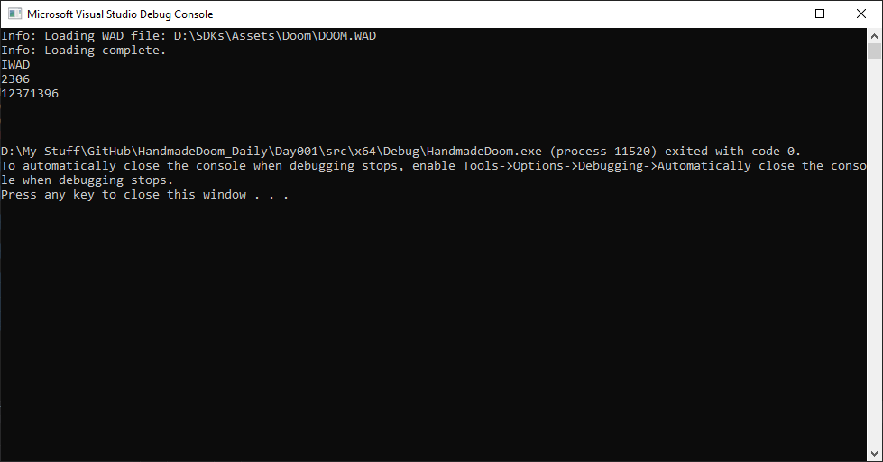
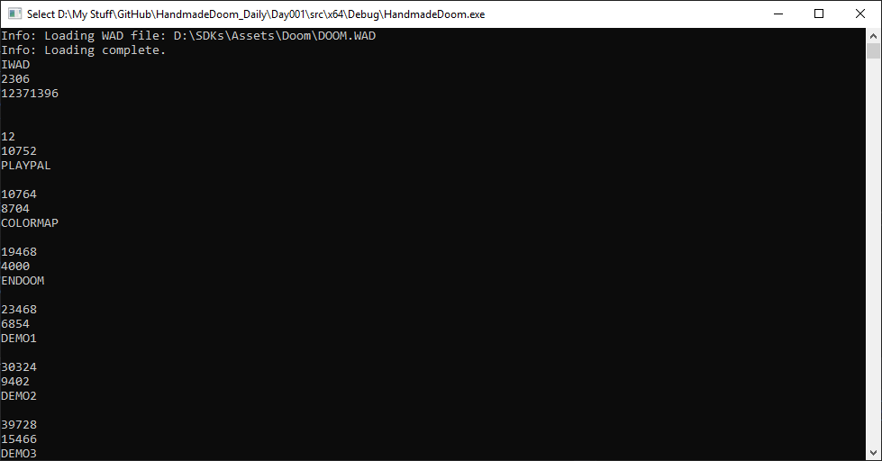
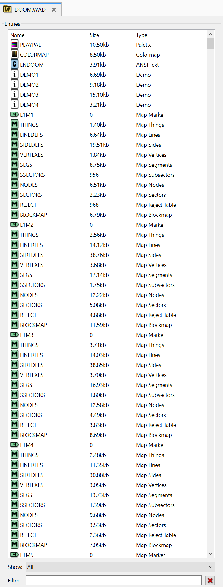

Reviewers:
*  Marl [@DOOMReboot](https://twitter.com/DOOMReboot)  
*  Luke [@flukejones](https://twitter.com/flukejones)

# Notes 001 - WAD Files  
Before we do any coding, let's spend some time setting some goals and think through what we want to achieve.  
As a start, let's see if we can read DOOM’s asset file. All DOOM assets and resources are stored in a WAD file.  

## What is a WAD file?  
"Where is All my Data"? It is in the WAD! WAD is an archive of all the assets in DOOM (and DOOM based games) in one file.  
Doom creators came up with this format to make it easy to modify the game.  

## WAD File Anatomy  
The WAD file has 3 main parts: header, lumps, and directories.  
1. Header  
   This contains basic information about the WAD file, including the directory offset.  
2. Lumps  
   This is where the game assets get stored, map data, sprites, music, etc.  
3. Directories  
   This is an organizational structure to find data in the lump section.  

  

### Header Format  
| Field Size | Data Type    | Content                                                        |  
|------------|--------------|----------------------------------------------------------------|  
| 0x00-0x03  | 4 ASCII char | *Must* be an ASCII string (either "IWAD" or "PWAD").           |  
| 0x04-0x07  | unsigned int | The number of entries in the directory.                        |  
| 0x08-0x0B  | unsigned int | Offset in bytes to the directory in the WAD file.              |  

### Directories Format  
| Field Size | Data Type    | Content                                                        |  
|------------|--------------|----------------------------------------------------------------|  
| 0x00-0x03  | unsigned int | Offset value to the start of the lump data in the WAD file.    |  
| 0x04-0x07  | unsigned int | The size of the lump in bytes.                                 |  
| 0x08-0x0f  | 8 ASCII char | ASCII holding the name of the lump.                            |  

## Goals  
1. Create a project.  
2. Open the WAD file.  
3. Read the header.  
4. Read all the directories and print them.  

## Design  
Let's keep things simple for now.  
Let's have a class to just open and load the WAD and call it WADLoader.  
Then let's have a class responsible for reading the Data based on their formats and call it WADReader.  
We will also need a simple main function that calls those classes.   

Note: this design might not be optimal but let's tune it as we need to.  

## Coding  
So, let's start by creating an empty C++ project. In Visual Studio, click File -> New -> Project. Let’s name it "DIYDoom".  

  

We'll add two new classes WADLoader, and WADReader.  
And we'll start by implementing WADLoader.  

``` cpp
class WADLoader
{
public:
    WADLoader(std::string sWADFilePath); // We always want to make sure a WAD file is passed
    bool LoadWAD(); // Will call other helper functions to open and load the WAD file

    ~WADLoader();   // Clean up!

protected:
    bool OpenAndLoad();     // Open the file and load it to memory
    bool ReadDirectories(); // A function that will iterate through the directory section 

    std::string m_sWADFilePath; // Store the file name passed to the constructor 
    std::ifstream m_WADFile;    // The file stream that will point to the WAD file.
    uint8_t *m_WADData;         // let's load the file and keep it in memory! It is just a few MBs!
    std::vector<Directory> m_WADDirectories; //let's store all the directories in this vector.
};
```
Implementing the constructor should be straight forward, just initialize the data pointer and keep a copy of the WAD file path that is passed.  
Implementing the constructor should be straightforward: initialize the data pointer and keep a copy of the WAD file path.  

``` cpp
WADLoader::WADLoader(string sWADFilePath) : m_WADData(NULL), m_sWADFilePath(sWADFilePath)
{
}
```
Now let's start implementing the helper load function `OpenAndLoad`, open the file as binary, and print an error if we fail.  

``` cpp
m_WADFile.open(m_sWADFilePath, ifstream::binary);
if (!m_WADFile.is_open())
{
    cout << "Error: Failed to open WAD file" << m_sWADFilePath << endl;
    return false;
}
```

If everything is going fine and we were able to open the file, we need to know the file size so we can allocate memory and copy the file into it.  

``` cpp
m_WADFile.seekg(0, m_WADFile.end);
size_t length = m_WADFile.tellg();
```

Now we know the WAD size in bytes, so let's allocate memory.  

``` cpp
m_WADData = new uint8_t[length]; 
```

And copy the file contents into that memory location.  

``` cpp
// remember to know the file size we had to move the file pointer all the way to the end! We need to move it back to the beginning.
m_WADFile.seekg(ifstream::beg);
m_WADFile.read((char *)m_WADData, length); // read the file and place it in m_WADData

m_WADFile.close();
```

Maybe you noticed that I used `uint8_t` for `m_WADData`. This means I want an array of exact 1-byte elements (1 byte * length). Using `uint8_t` guarantees an 8-bit unsigned integer.  
If we want to allocate 2 bytes (16 bits) we would use uint16_t, which we will come across later! Using such types makes it platform independent.  
Just to clarify, if we use `int`, the size is implementation-defined. On most modern compilers/platforms it’s usually 4 bytes (32 bits), but it can vary by target and ABI.  

Let's give this a quick test and see if things are working! But before we do that, we need to implement `LoadWAD`.  
For now, `LoadWAD` will call `OpenAndLoad`.  

``` cpp
bool WADLoader::LoadWAD()
{
    if (!OpenAndLoad())
    {
        return false;
    }

    return true;
}
```

And in our `main` function, we’ll create an instance of our class and try to load the WAD.  
The supplied WAD is the DOOM Shareware version; you can replace it with the Steam version.

``` cpp
int main()
{
    WADLoader wadloader("..\\..\\..\\external\\assets\\DOOM.WAD");
    wadloader.LoadWAD();
    return 0;
}
```  

__You might need to type in the correct path of your WAD file.__  
Let's run it!  

Oh! A console window that opens for a few seconds. Nothing much to see... did it work?  
I have an idea! Let's look at the memory and see what it looks like! Maybe we can see something special there!  
First, let's place a breakpoint by double-clicking on the left of the line number, you should see something like this.  



I placed my breakpoint just after reading all the bytes from the file, so I can look at that array in memory and see what is loaded in it.  
Now let's click Run again.  
In the auto window, I can see the first few bytes! It is reading "IWAD" in the first 4 bytes! WOW! It is working! I never thought this day would come!  
Come on! Pull yourself together there is still more to do!  



## Reading the header
The header is 12 bytes (0x00 to 0x0B). It’s divided into 3 fields: the first 4 bytes are the WAD type (usually "IWAD" or "PWAD"). "IWAD" indicates an official game WAD, while "PWAD" is generally used for user-created add-ons. Note that the string is not NULL-terminated, so be careful.  
The next 4 bytes are an unsigned int holding the number of directory entries.  
The final 4 bytes are the byte offset of the directory.  

Now add a struct that will hold this information for us. I'm adding a new header file called "DataTypes.h" there we will define any structs we need.  

``` cpp
struct Header
{
    char WADType[5]; // I added an extra character to add the NULL
    uint32_t DirectoryCount; //uint32_t is 4 bytes (32 bits)
    uint32_t DirectoryOffset; // The offset where the first directory is located.
};
```

Now we need to implement the `WADReader` class. This class will read data from the loaded WAD byte array.  

Let's add 2 functions to read 16-bit or 32-bit values from the byte array.  

``` cpp
uint16_t WADReader::Read2Bytes(const uint8_t *pWADData, int offset)
{
    uint16_t ReadValue;
    std::memcpy(&ReadValue, pWADData + offset, sizeof(uint16_t));
    return ReadValue;
}

uint32_t WADReader::Read4Bytes(const uint8_t *pWADData, int offset)
{
    uint32_t ReadValue;
    std::memcpy(&ReadValue, pWADData + offset, sizeof(uint32_t));
    return ReadValue;
}
```

Now we are ready to read the header, read the first four bytes as a char, then let's add the NULL to it so it would be easier for us to handle. For the directory count and directory offset we could just use our helper functions to convert them to the correct format.  

``` cpp
void WADReader::ReadHeaderData(const uint8_t *pWADData, int offset, Header &header)
{
    //0x00 to 0x03
    header.WADType[0] = pWADData[offset];
    header.WADType[1] = pWADData[offset + 1];
    header.WADType[2] = pWADData[offset + 2];
    header.WADType[3] = pWADData[offset + 3];
    header.WADType[4] = '\0';

    //0x04 to 0x07
    header.DirectoryCount = Read4Bytes(pWADData, offset + 4);

    //0x08 to 0x0b
    header.DirectoryOffset = Read4Bytes(pWADData, offset + 8);
}
```

Now stitch everything together and call those functions to print out the results.  

``` cpp
bool WADLoader::ReadDirectories()
{
    WADReader reader;

    Header header;
    reader.ReadHeaderData(m_WADData, 0, header);

    std::cout << header.WADType << std::endl;
    std::cout << header.DirectoryCount << std::endl;
    std::cout << header.DirectoryOffset << std::endl;
    std::cout << std::endl << std::endl;
    return true;
}
```
Let’s run and see if this is working!  


Cool! It’s easy to validate the "IWAD" string, but do the other 2 numbers look correct? Let’s try to read the directories using that offset and see if it works.  

We will have to add a new struct to handle the directory matching the specs listed above  .

``` cpp
struct Directory
{
    uint32_t LumpOffset;
    uint32_t LumpSize;
    char LumpName[9];
};
```

Now let's update `ReadDirectories` to read directory entries and print them.  
In each iteration, we add \(i * 16\) to move to the next directory entry (each entry is 16 bytes).  

``` cpp
Directory directory;

for (unsigned int i = 0; i < header.DirectoryCount; ++i)
{
    reader.ReadDirectoryData(m_WADData, header.DirectoryOffset + i * 16, directory);

    m_WADDirectories.push_back(directory);

    std::cout << directory.LumpOffset << std::endl;
    std::cout << directory.LumpSize << std::endl;
    std::cout << directory.LumpName << std::endl;
    std::cout << std::endl;
}
```

Let's run this now and see what happens.  
Wow! A big list of directories.  

  

From the lump names, we can assume we read the data correctly but let’s validate it.  
We can have a look at the WAD Directory entries using Slade3.  

  

It seems the name, and the lump size matches the output of our code.  
I think we are good for today!  

## Other Notes
* At some point I thought using a vector to store the directories might not be smart. Why not use a map for faster lookup than a linear search? That’s not ideal here: a `std::map` won’t preserve directory entry order, and we’ll need that later.  
Also, one common misconception: `std::map` is typically implemented as a balanced tree (commonly a red-black tree), so lookup is \(O(\log N)\), and iteration yields keys in sorted order. If you want average \(O(1)\) lookup (worst case \(O(N)\)), use `std::unordered_map`.  
* Loading all the WAD files to memory is not the optimal way to do this. It would make more sense to just read the header and directories to memory, then based on the code flow needs we would go back to the WAD file and load the resources from the disk. Hopefully at some point we learn more about caching.  

In Chocolate Doom, tracing the WAD loading might be a little hard if you have no experience with C, so here’s a high-level overview. In the main entry point `D_DoomMain`, a sequence of steps happens so the correct WAD file is located and loaded:
* `D_FindIWAD` checks whether the executable was started with the `-iwad` argument.
    * If `-iwad` is specified, it uses that file.
    * Otherwise, it searches for an IWAD (e.g. via `SearchDirectoryForIWAD`).
* Once a WAD file is found, it’s opened in `W_AddFile` and assigned to the variable `wad_file` (type `wad_file_t`, defined in `w_file.h`).

``` cpp
typedef struct _wad_file_s wad_file_t;

typedef struct
{
    // Open a file for reading.
    wad_file_t *(*OpenFile)(const char *path);

    // Close the specified file.
    void (*CloseFile)(wad_file_t *file);

    // Read data from the specified position in the file into the 
    // provided buffer.  Returns the number of bytes read.
    size_t (*Read)(wad_file_t *file, unsigned int offset,
                   void *buffer, size_t buffer_len);
} wad_file_class_t;

struct _wad_file_s
{
    // Class of this file.
    wad_file_class_t *file_class;

    // If this is NULL, the file cannot be mapped into memory.  If this
    // is non-NULL, it is a pointer to the mapped file.
    byte *mapped;

    // Length of the file, in bytes.
    unsigned int length;

    // File's location on disk.
    const char *path;
};
```
Here’s the tricky part: the file backend is represented by a `wad_file_class_t`, which holds function pointers for opening, closing, and reading a file.  

Why the complexity? Because behavior differs across platforms. Some platforms support memory-mapped files (`mmap` on POSIX systems). At compile time, the build selects which file backend(s) are available based on platform macros and configuration.  

```
extern wad_file_class_t stdc_wad_file;

#ifdef _WIN32
extern wad_file_class_t win32_wad_file;
#endif

#ifdef HAVE_MMAP
extern wad_file_class_t posix_wad_file;
#endif 

static wad_file_class_t *wad_file_classes[] = 
{
#ifdef _WIN32
    &win32_wad_file,
#endif
#ifdef HAVE_MMAP
    &posix_wad_file,
#endif
    &stdc_wad_file,
};
```

## Source code  
[Source code](../src)  

## Reference  
[Doom Wiki](https://doomwiki.org/wiki/WAD)  
[ZDoom Wiki](https://zdoom.org/wiki/WAD)  
